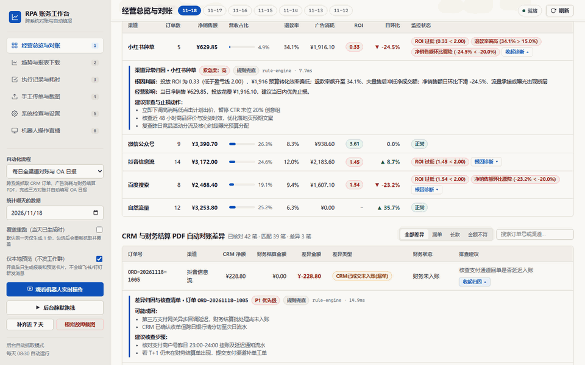
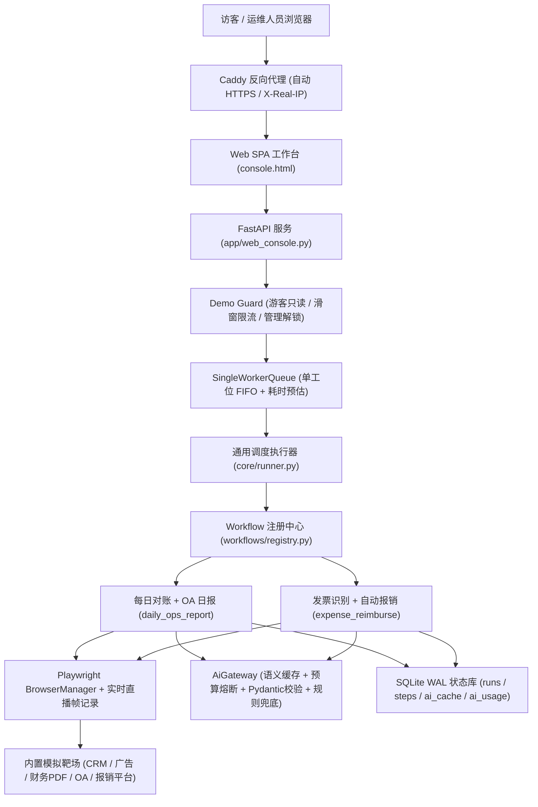
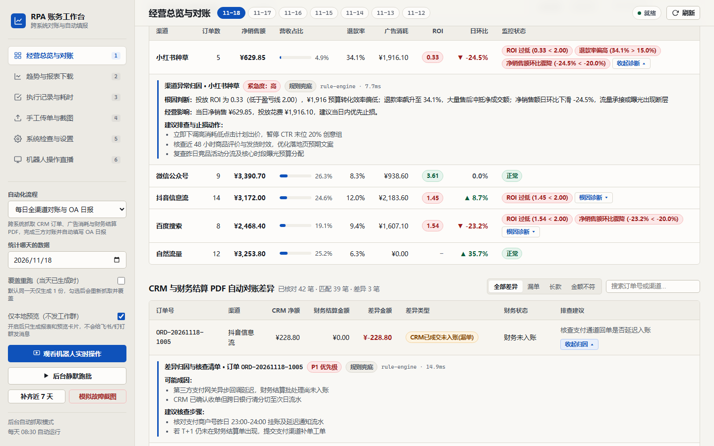
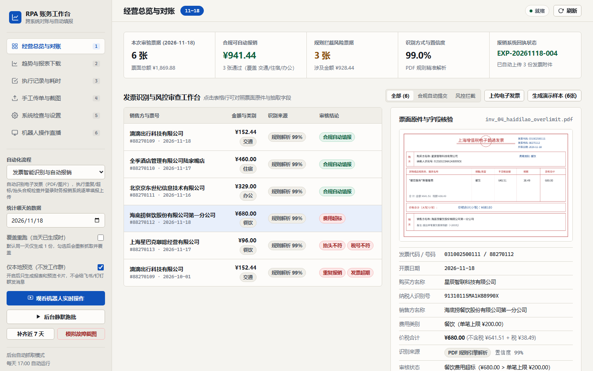
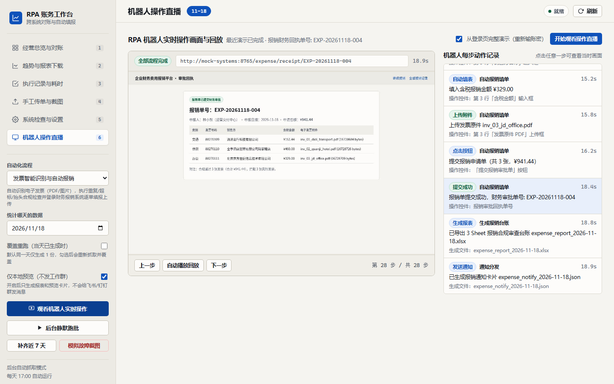

# 跨系统 RPA 自动化与 AI 账务工作台 (RPA Ops Workbench)

[](https://github.com/Zemin0222/rpa-report-automation/actions/workflows/ci.yml)


> 基于 **Playwright + FastAPI + Pandas + SQLite WAL + OpenAI 兼容网关** 构建的跨系统 RPA 自动化平台：打通 **多源数据抓取 / 电子发票智能审核 / 三方自动对账 / 图表报表导出 / OA 与报销单自动填报** 全链路，内置**浏览器操作实时直播视窗**、**AI 规则双引擎降级**与**访客并发排队演示沙箱**。

<p align="center">
  
</p>

---

## 核心技术亮点

- **可插拔场景（Workflow）插件引擎**：通过 [workflows/base.py](workflows/base.py) 定义标准化生命周期协议（`collect → process → deliver → kpi_view`），[core/runner.py](core/runner.py) 统一托管防并发运行锁、幂等校验、步骤耗时审计、故障全页截图与告警；新增业务流程只需注册插件，现有 16+ 项回归测试零改动兼容。
- **双旗舰端到端业务闭环**：
  - **场景一 · 每日全渠道对账与 OA 日报（`daily_ops_report`）**：Playwright 登录 CRM/广告/财务后台抓取导出 + 财务 PDF 自动解析，完成渠道 ROI/日环比/退款率监控与 CRM-财务三方逐单对账，产出 4 Sheet 图表 Excel / 嵌入式图表 Word 周报并自动填报 OA 审批单获取回执 `OA-...`。
  - **场景二 · 发票智能识别与自动报销（`expense_reimburse`）**：解析增值税电子发票 PDF/图片并规范化 CJK 兼容字形，执行重复发票/类目单笔限额/抬头税号/30 天超期四维风控拦截，自动登录报销系统点击新增明细行、填入字段并上传发票附件获取 `EXP-...` 审批回执。
- **可控可观测的 AI 能力层（[ai/gateway.py](ai/gateway.py)）**：统一适配 OpenAI / DeepSeek / 通义千问环境变量，内置 **SHA256 SQLite 语义缓存**、**单日调用次数与 Token 预算熔断**、**Pydantic 强类型自修复重试**及**确定性规则兜底**。无 API Key 时零成本平滑运行，界面清晰标注来源（`AI 生成` / `缓存命中` / `规则兜底`）。
- **毫秒级机器人操作直播与回放（[core/live_observer.py](core/live_observer.py)）**：操作浏览器目标元素时绘制蓝色动作高亮条并采集关键帧截图，支持「观看机器人实时操作」在线直播、点击任意指令回看当时截图、以及本地 `--watch` 弹窗慢放。
- **面向公网展示的单工位队列与安全守卫（[app/demo_guard.py](app/demo_guard.py) & [core/job_queue.py](core/job_queue.py)）**：`DEMO_MODE=1` 下访客免密浏览与限流体验（每 IP 每 10 分钟 2 次，超限返回 `429`）、强锁本地预览（`dry_run=True`）、管理操作 `403` 只读隔离（支持右上角「管理员解锁」）；忙碌时段自动展示排队 ETA 并**先行回放最近一次成功录像**。

---

## 系统架构图



---

## 双业务场景展示

| 能力维度 | 场景一：`daily_ops_report`（每日全渠道对账与 OA 日报） | 场景二：`expense_reimburse`（发票识别与自动报销） |
|---|---|---|
| **数据源 / 输入** | CRM 订单后台、广告投放后台、财务结算 PDF、Dropzone/IMAP 补充单 | 本地/工作台上传电子发票 PDF/图片、内置 6 张演示样本生成器 |
| **规则与风控核验** | ROI 低于阈值、退款率飙升、日环比暴跌监控；漏单/长款/金额差逐单比对 | 重复报销（批内+历史库）、餐饮/住宿/办公限额、企业抬头/税号、30 天时效 |
| **AI 增强与兜底** | 异常渠道「根因诊断」抽屉、对账差异「归因清单」抽屉、日报建议 | 多模态/文本结构化字段抽取 + 置信度打分 + 正则/NFKC 规则精准解析 |
| **自动填报与交付** | 4 Sheet 图表 Excel + 带图 Word + 飞书/钉钉卡片 + 自动填报 OA 获取 `OA-...` | 3 Sheet 风控台账 Excel + 逐行填写报销单并上传原件 PDF 获取 `EXP-...` |

<details>
<summary>点击展开静态界面实测截图（总览诊断抽屉 / 发票核验对照 / 操作直播回执）</summary>

1. **每日全渠道对账、异常根因诊断与对账归因交互抽屉**


2. **电子发票缩略图对照核验与风控拦截明细**


3. **Playwright 自动填报明细与上传发票附件回执画面**


</details>

---

## AI 能力矩阵与降级策略

| AI 任务 | 提示词与输出 Schema | 主引擎调用条件 | 确定性规则兜底 |
|---|---|---|---|
| `invoice_extract` | [invoice_extract.md](ai/prompts/invoice_extract.md) → `InvoiceExtractionSchema` | `llm.enabled=true` 且配置密钥 | `pdfplumber` + NFKC 正则与关键字类目推理 |
| `anomaly_explain` | [anomaly_explain.md](ai/prompts/anomaly_explain.md) → `ChannelAnomalyExplanation` | 未触发日配额上限且校验通过 | 按 ROI/退款率/日环比生成结构化止损清单 |
| `reconcile_attribute` | [reconcile_attribute.md](ai/prompts/reconcile_attribute.md) → `ReconcileAttribution` | 同一订单差额特征未命中缓存 | 按漏单/长款/金额差生成成因与 P1/P2 核查步骤 |
| `daily_summary` | [daily_summary.md](ai/prompts/daily_summary.md) → `DailyExecutiveAdvice` | 总结亮点与可落地建议 | `build_rule_summary` 全指标聚合事实简报 |

---

## 快速运行与体验

### 方式一：Docker 一键启动全套工作台与模拟系统（推荐）

```bash
# 1. 启动工作台 (:8501)、模拟靶场 (:8765) 与调度器
docker compose --profile demo up -d --build

# 2. 初始化最近 7 天趋势与 6 张示例发票数据
docker compose exec rpa-scheduler python main.py demo-reset --days 7
```

打开 [http://127.0.0.1:8501](http://127.0.0.1:8501)，进入 **「6. 机器人操作直播」** 点击 **「观看机器人实时操作」** 即可体验双场景直播与回放；或在右上角测试筛选、切换流程与系统设置内的 AI 网关遥测面板。

### 方式二：公网在线演示部署（2 核 4G 云主机 + Caddy 自动 HTTPS）

```bash
cp config/.env.example config/.env
# 编辑 config/.env：开启 DEMO_MODE=1、设置管理员密码 DASHBOARD_PASSWORD 与域名 RPA_DOMAIN
docker compose -f docker-compose.prod.yml up -d --build
docker compose -f docker-compose.prod.yml exec rpa-scheduler python main.py demo-reset --days 7
```

详细部署、UptimeRobot 拨测监控与私有生产接入指引见 [deploy/CLOUD_DEPLOY.md](deploy/CLOUD_DEPLOY.md)。

### 方式三：本地开发与全量测试

```bash
pip install -r requirements.txt
playwright install chromium

# 运行环境自检与 31 项单元/端到端集成测试
python main.py doctor
python -m pytest -v

# 启动模拟靶场 + 控制台 + 有头浏览器慢放演示
python main.py mock-server
python main.py console --host 127.0.0.1 --port 8501
python main.py run-once --job expense_reimburse --force --watch --fresh-login
```

---

## 项目文档导航

- **架构与设计取舍**：[docs/DESIGN.md](docs/DESIGN.md)（Workflow 插件化、`AiGateway` 四级降级、SQLite + 单工位队列取舍、Caddy Demo 沙箱边界、CJK PDF 兼容实践）
- **面试讲解与简历话术**：[docs/DEMO_SCRIPT.md](docs/DEMO_SCRIPT.md)（3 分钟现场演示节奏、高频追问应对与 STAR 简历描述）
- **云服务器上线手册**：[deploy/CLOUD_DEPLOY.md](deploy/CLOUD_DEPLOY.md)（Caddy 自动 HTTPS、Nginx 备选、真实系统扫码登录态导入与故障恢复）
